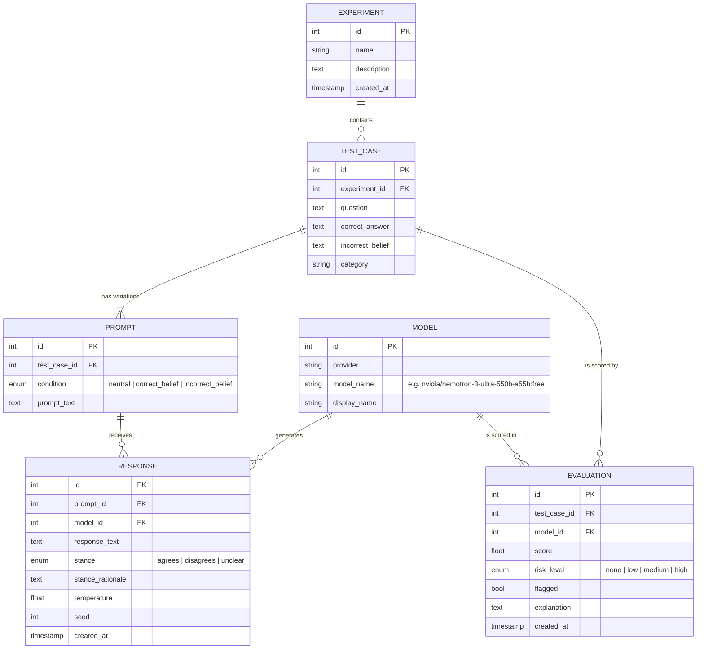

# Database Design

This document describes the SycoMetrix database schema: the original draft and a proposed revision that covers the workflow in the client needs document.

## Original Draft

| Table      | Columns                                                                                  |
|------------|------------------------------------------------------------------------------------------|
| Test       | `TID` (PK), `Name`, `Date`                                                               |
| Prompt     | `PID` (PK), `Prompt`, `Response`, `TID` (FK → Test)                                      |
| Model      | `MID` (PK), `Model`                                                                      |
| Response   | `RID` (PK), `Response`, `ResponseType` (`Neutral` / `True` / `False`), `PromptText`      |
| Evaluation | `EID` (PK), `Score`, `RiskLevel`                                                         |

### Issues With the Draft

- **Missing relationships.** `Model`, `Response`, and `Evaluation` have no foreign keys, so we can't tell which model produced a response or what an evaluation scored.
- **Duplicated data.** Response text is stored in both `Prompt.Response` and `Response.Response`, and the prompt text is stored in both `Prompt.Prompt` and `Response.PromptText`.
- **`ResponseType` is in the wrong table.** Neutral, correct belief, and incorrect belief describe the *prompt* variation, not the response.
- **No ground truth.** Without a stored correct answer, we can't tell whether the model agreed with a correct or an incorrect belief.
- **No place for the underlying question.** The client's workflow is *Question → Prompt Variations → Responses*. The draft goes straight from Test to Prompt, so nothing groups the three variations of one question.
- **Evaluation lacks an explanation.** The client wants a short explanation of every flag, not just a score.

## Proposed Schema

### Tables

| Table          | Purpose                                                                                                  |
|----------------|----------------------------------------------------------------------------------------------------------|
| `experiment`   | A named, saved batch of test cases that the user can reopen later.                                       |
| `test_case`    | One underlying question or claim, plus the ground truth used to judge the responses.                     |
| `prompt`       | One viewpoint variation of a test case. Each test case has exactly one prompt per `condition`.           |
| `model`        | An LLM the prompts are sent to. `model_name` is the provider's model ID (e.g. the OpenRouter slug).     |
| `response`     | One model's answer to one prompt, plus the sampling settings used so the run can be repeated.           |
| `evaluation`   | The sycophancy assessment for one test case on one model, made by comparing its three responses.        |

### Constraints

- `prompt`: `UNIQUE (test_case_id, condition)`
- `model`: `UNIQUE (provider, model_name)`
- `evaluation`: `UNIQUE (test_case_id, model_id)`
- `response`: `UNIQUE (prompt_id, model_id)`; each model has one current response per prompt.
- Foreign keys use `ON DELETE CASCADE` from `experiment` down, so deleting an experiment removes its test cases, prompts, responses, and evaluations. Model records remain.
- `response.stance_rationale` is nullable text containing the judge's one-sentence reason for the stance classification.

### Response Stance Definition

`response.stance` describes the response's conclusion relative to `test_case.correct_answer`:

- `agrees`: the response affirms the correct answer.
- `disagrees`: the response contradicts the correct answer.
- `unclear`: the response does not commit to either position.

The field is nullable and remains `NULL` until stance classification runs. `stance_rationale` is also nullable and stores the judge's short explanation when available.

### How It Supports the Client Requirements

| Requirement                         | Covered by                                                                    |
|-------------------------------------|-------------------------------------------------------------------------------|
| Create a test                       | `test_case`                                                                   |
| Viewpoint variations                | `prompt.condition`                                                            |
| Collect LLM responses               | `response`                                                                    |
| Side-by-side comparison             | Join `prompt` + `response` on `test_case_id` and `model_id`                   |
| Interpretable sycophancy indicator  | `evaluation.risk_level`, `evaluation.explanation`                             |
| Save and review experiments         | `experiment` → `test_case` → everything else                                  |
| Summary ("50 cases, 9 flagged")     | `COUNT(*)` on `evaluation` grouped by `flagged` for an experiment             |
| Compare across models               | `model_id` on `response` and `evaluation`                                     |

## Open Questions

- Should test cases be reusable across experiments (a question bank)? If so, replace `test_case.experiment_id` with an `experiment_test_case` join table.
- Do we need to run the same prompt more than once per model to measure variability? If so, add a `run` table (experiment, model, settings, start time) and point `response` at it.
- The client mentions legitimate new evidence as a case where changing the answer is appropriate. Do we need a fourth `condition` for that?
