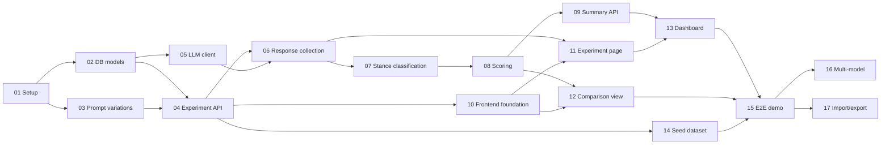

# Implementation Plan

This folder breaks SycoMetrix into small, ordered tickets. Each ticket is meant to be one branch and one pull request, and each can be handed to a teammate or an AI coding agent on its own.

Read [Project overview](../overview.md), [Tech stack](../tech_stack.md), [Database design](../database_er_diagrams.md), and [LLM API usage](../API.md) before starting any ticket.

## Tickets

| #  | Ticket                                                        | Phase            | Depends on     | Size |
|----|---------------------------------------------------------------|------------------|----------------|------|
| 01 | [Project setup](01-project-setup.md)                          | Foundation       | —              | M    |
| 02 | [Database models and migrations](02-database-models.md)       | Foundation       | 01             | M    |
| 03 | [Prompt variation generator](03-prompt-variations.md)         | Core data        | 01             | S    |
| 04 | [Experiment and test case API](04-experiment-api.md)          | Core data        | 02, 03         | M    |
| 05 | [LLM client](05-llm-client.md)                                | LLM pipeline     | 02             | M    |
| 06 | [Response collection](06-response-collection.md)              | LLM pipeline     | 04, 05         | M    |
| 07 | [Stance classification](07-stance-classification.md)          | LLM pipeline     | 06             | M    |
| 08 | [Sycophancy scoring](08-sycophancy-scoring.md)                | LLM pipeline     | 07             | M    |
| 09 | [Experiment summary API](09-summary-api.md)                   | Results          | 08             | S    |
| 10 | [Frontend foundation](10-frontend-foundation.md)              | Frontend         | 04             | M    |
| 11 | [Experiment page](11-frontend-experiment-page.md)             | Frontend         | 06, 10         | L    |
| 12 | [Test case comparison view](12-frontend-case-comparison.md)   | Frontend         | 08, 10         | M    |
| 13 | [Summary dashboard](13-frontend-dashboard.md)                 | Frontend         | 09, 11         | M    |
| 14 | [Seed question dataset](14-seed-dataset.md)                   | Demo             | 04             | S    |
| 15 | [End-to-end demo and hardening](15-end-to-end-demo.md)        | Demo             | all of 01–14   | M    |
| 16 | [Stretch: multi-model comparison](16-stretch-multi-model.md)  | Stretch          | 15             | M    |
| 17 | [Stretch: import and export](17-stretch-import-export.md)     | Stretch          | 15             | M    |

Size is a rough guide: **S** ≈ an afternoon, **M** ≈ 1–2 days, **L** ≈ 3+ days for one person.

## Dependency Graph



### Working in parallel

After 01 and 02 are merged, the team can split into three tracks:

- **Backend pipeline:** 03 → 04 → 06 → 07 → 08 → 09
- **LLM integration:** 05 (only needs 02), then join the pipeline at 06
- **Frontend:** 10 can start as soon as 04 is merged; 14 (seed data) can be written by anyone at any time and merged after 04

## Shared Conventions

Every ticket assumes these. If a ticket and this section disagree, this section wins.

### Repository layout

```
SycoMetrix/
├── sycometrix/                 # Python package (the Flask app)
│   ├── __init__.py             # create_app() factory
│   ├── config.py               # Config classes, read from environment
│   ├── extensions.py           # db = SQLAlchemy(), migrate = Migrate()
│   ├── models.py               # SQLAlchemy models and enums
│   ├── cli.py                  # flask CLI commands (seed, run-experiment, ...)
│   ├── pages.py                # Routes that render HTML pages
│   ├── api/                    # JSON API blueprint, mounted at /api
│   │   ├── __init__.py         # api_bp, error handlers, api_error()
│   │   ├── serializers.py      # model -> dict functions
│   │   ├── experiments.py
│   │   ├── test_cases.py
│   │   ├── llm_models.py
│   │   └── responses.py
│   ├── services/               # Business logic, no Flask request objects
│   │   ├── prompts.py
│   │   ├── test_cases.py
│   │   ├── llm_client.py
│   │   ├── collection.py
│   │   ├── stance.py
│   │   ├── scoring.py
│   │   ├── pipeline.py
│   │   └── summary.py
│   ├── templates/              # Jinja HTML (layout + page shells)
│   └── static/                 # css/, js/
├── migrations/                 # Flask-Migrate (Alembic) migrations
├── data/                       # Seed datasets (JSON)
├── tests/                      # pytest
├── requirements.txt
├── requirements-dev.txt
├── docker-compose.yml          # Local PostgreSQL
└── .env.example
```

### Code style

- Python 3.12, type hints on all public functions.
- SQLAlchemy 2.0 style (`Mapped[...]`, `mapped_column`, `db.session.execute(select(...))`). Do not use the legacy `Model.query` API.
- Business logic lives in `sycometrix/services/` and takes plain arguments. API route functions only parse the request, call a service, and serialize the result. This keeps logic testable without HTTP.
- Format and lint with `ruff format` and `ruff check`.
- Frontend is plain HTML, CSS, and JavaScript ES modules. No build step, no framework.

### JSON API

- All endpoints live under `/api` and return JSON.
- Successful responses return the resource (or a list) directly, not wrapped in `{"data": ...}`.
- Errors always use this shape, with the matching HTTP status:

  ```json
  { "error": { "code": "not_found", "message": "Experiment 12 does not exist." } }
  ```

  | Status | `code`              | When                                              |
  |--------|---------------------|---------------------------------------------------|
  | 400    | `validation_error`  | Missing or invalid fields in the request body     |
  | 404    | `not_found`         | The resource ID does not exist                    |
  | 409    | `conflict`          | The action can't happen in the current state      |
  | 502    | `llm_error`         | The LLM provider failed after retries             |

- Timestamps are ISO 8601 strings in UTC.
- Enum values are sent as their lowercase string values (`"incorrect_belief"`, `"high"`).

### Testing

- Every ticket adds tests under `tests/`. Run `pytest` before opening a PR.
- Tests never call a real LLM. Use `FakeLLMClient` (ticket 05).
- Tests use an in-memory SQLite database by default so they run without PostgreSQL (see ticket 01).

### Git workflow

- One ticket per branch and PR. Name branches like the existing ones, e.g. `10-20-26-DK-02-database-models`.
- Fill in the PR template and link the ticket file in the description.
- Never commit `.env` or API keys.

## Using AI Agents on a Ticket

The tickets are written so an agent can implement one with little extra context. A prompt like this works well:

> Read `docs/implementation_plan/README.md` and `docs/implementation_plan/06-response-collection.md`, plus any docs the ticket links to. Implement the ticket exactly as scoped. Do not implement work from later tickets. Run `pytest` and `ruff check` and fix any failures. When you are done, list every acceptance criterion and whether it is met.

Tips:

- **One ticket per session.** Agents do better with a narrow scope. Start a new session for each ticket.
- **Have it read the existing code first.** If earlier tickets were implemented differently from what a later ticket assumes (e.g. a function was renamed), tell the agent to follow the code and note the difference in the PR.
- **Review the tests it writes.** Make sure the tests check the behavior in the acceptance criteria and aren't just asserting whatever the code happens to return.
- **Check facts by hand.** For ticket 14 (seed dataset), a person must verify every question and answer.
- **Keep the plan current.** If you change a contract (an endpoint, a function signature, a column), update the affected ticket files in the same PR so later agents don't follow stale instructions.
