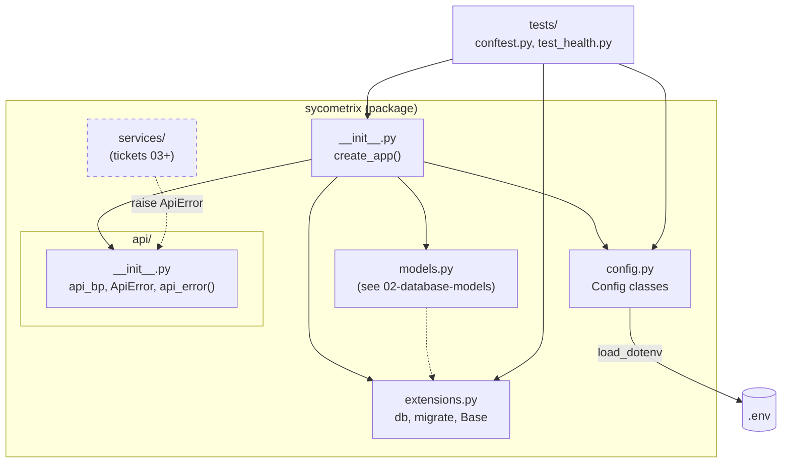
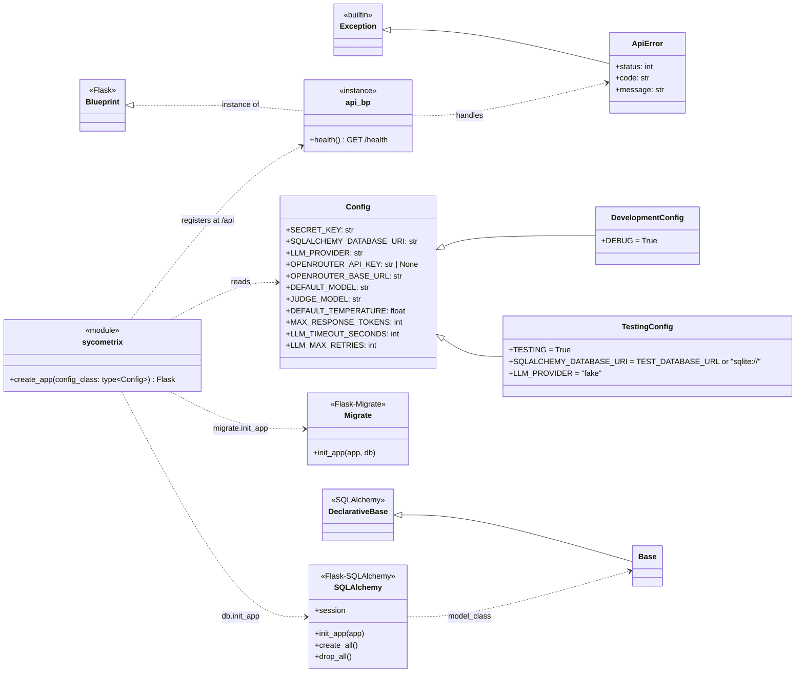
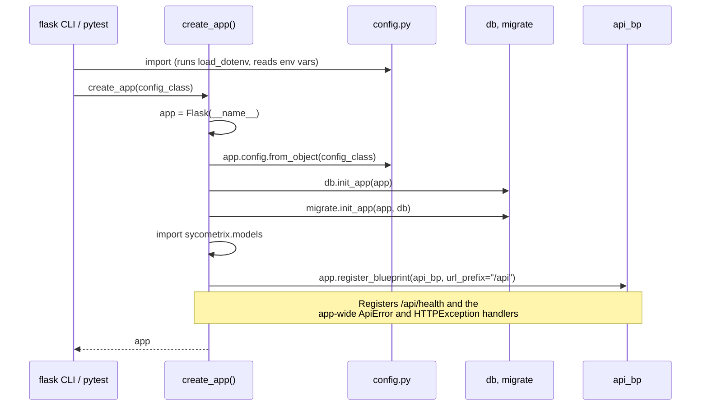
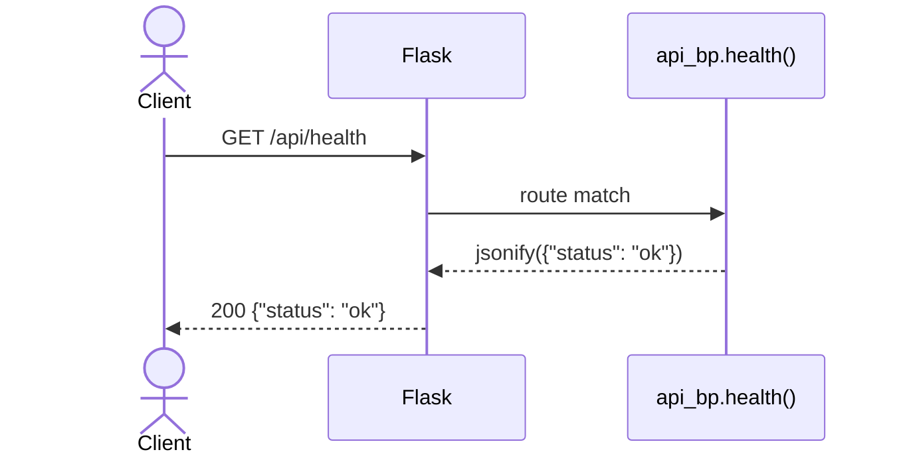
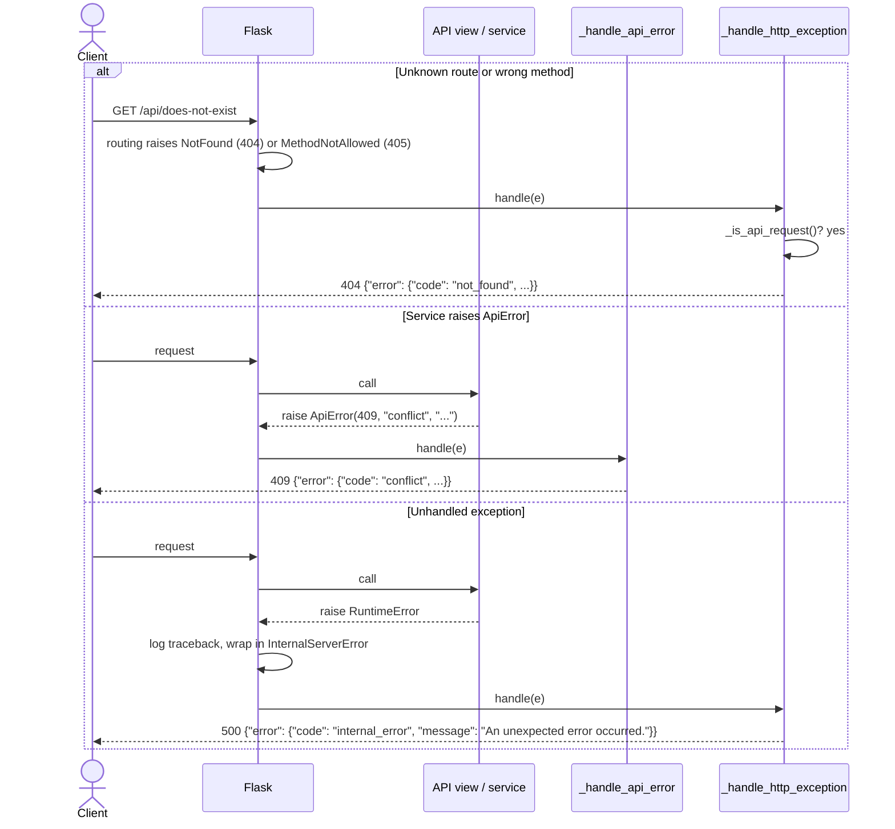
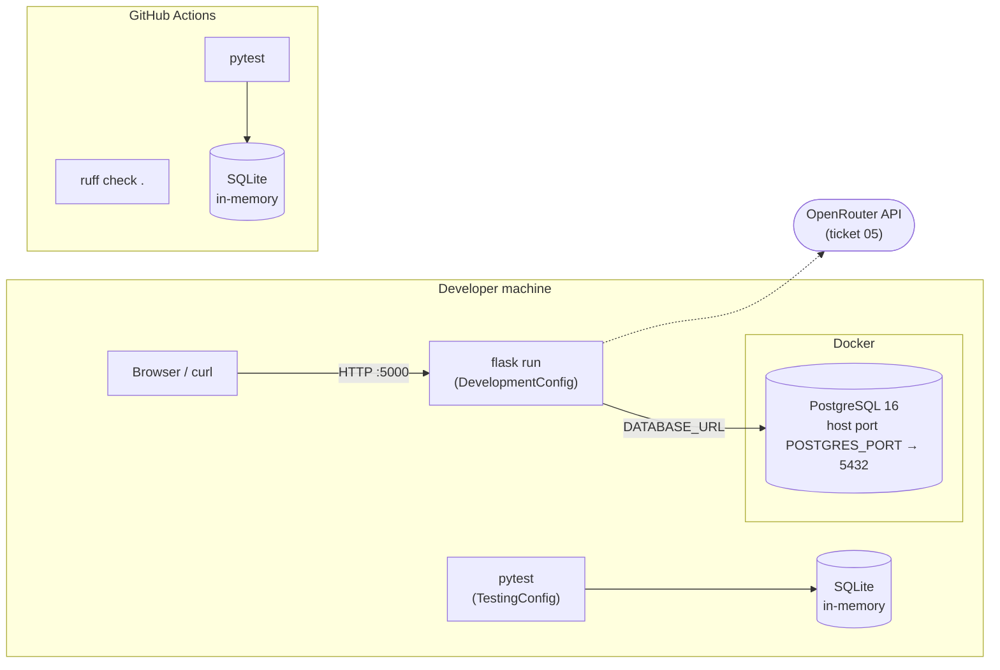

# 01 — Project Setup: Design

Ticket: [01 — Project setup](../implementation_plan/01-project-setup.md)

This ticket builds the Flask skeleton: the app factory, configuration, database extensions, and the JSON API blueprint with its shared error handling. There are no features yet; every later ticket plugs into the pieces shown here.

## Package Diagram

Which modules exist and how they depend on each other. Dashed boxes are placeholders that later tickets fill in.

Source: [`sycometrix/`](../../sycometrix/)

## Class Diagram

Source: [`config.py`](../../sycometrix/config.py), [`extensions.py`](../../sycometrix/extensions.py), [`api/__init__.py`](../../sycometrix/api/__init__.py), [`__init__.py`](../../sycometrix/__init__.py)

## Sequence Diagrams

### App startup

`flask run` finds the factory through `FLASK_APP=sycometrix`. Tests call `create_app(TestingConfig)` directly.

### `GET /api/health`

### Error handling

How the three kinds of failure become the shared JSON error shape `{"error": {"code", "message"}}`.

Status codes map to error codes like this: 400 `validation_error`, 404 `not_found`, 405 `method_not_allowed`, 409 `conflict`, 500 `internal_error`, 502 `llm_error`. Any other HTTP error uses its name in snake case (e.g. 415 `unsupported_media_type`).

## Deployment Diagram

What runs where during local development and in CI.

## Design Notes

- **Error handlers are app-wide, not blueprint-only.** Flask raises 404 and 405 during routing, before it knows a request belongs to `api_bp`, so a blueprint-scoped handler never sees them. The handlers are registered with `app_errorhandler` and check `_is_api_request()` (path starts with `/api`). Non-API paths fall through to Flask's normal HTML error pages, which the frontend pages (ticket 10) can rely on.
- **500 responses never include exception details.** Flask logs the traceback before calling the handler; the response body only says "An unexpected error occurred."
- **Empty env vars count as unset.** `.env.example` lists every variable, some with empty values (e.g. `JUDGE_MODEL=`). `config.py` treats an empty value as missing, so `JUDGE_MODEL` falls back to `DEFAULT_MODEL` instead of becoming `""`.
- **SQLite foreign keys.** A SQLAlchemy `connect` listener runs `PRAGMA foreign_keys=ON` for SQLite only, so `ON DELETE CASCADE` (ticket 02) behaves the same in tests as in PostgreSQL.
- **Configurable PostgreSQL port.** `docker-compose.yml` maps `${POSTGRES_PORT:-5432}`, because a local PostgreSQL already on 5432 silently intercepts connections meant for the container.
- **No packaging.** `pyproject.toml` only configures ruff and pytest. pytest finds the package via `pythonpath = ["."]`, and ruff skips Markdown so it doesn't reformat example code in the docs.
