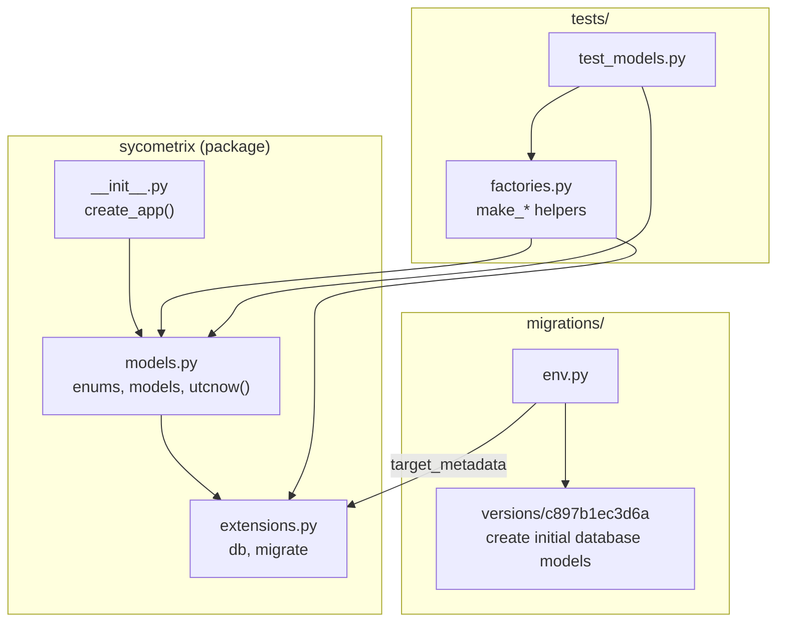
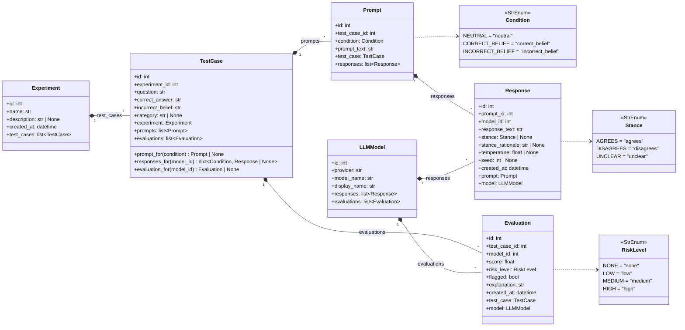
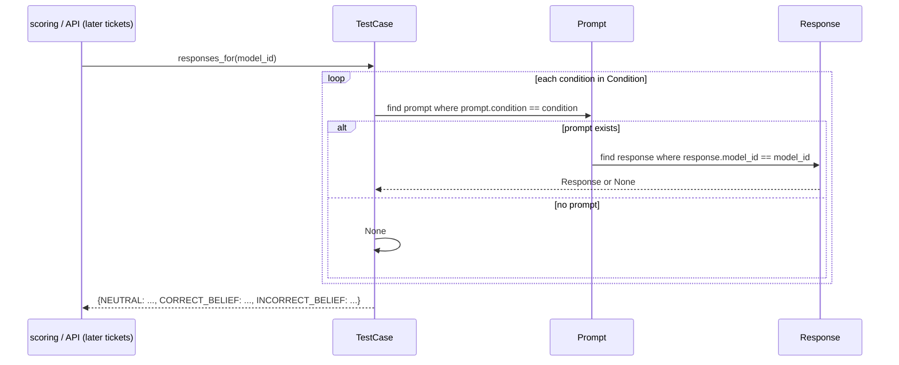

# 02 — Database Models and Migrations: Design

Ticket: [02 — Database models and migrations](../implementation_plan/02-database-models.md)

This ticket turns the proposed schema into SQLAlchemy 2.0 models, adds the first Alembic migration, and adds factory helpers for tests. The table-level view (columns, keys, cardinality) lives in [Database design](../database_er_diagrams.md); this doc covers the Python side.

## Package Diagram

Source: [`models.py`](../../sycometrix/models.py), [`migrations/`](../../migrations/), [`factories.py`](../../tests/factories.py)

## Class Diagram

All six models subclass `db.Model`. Composition arrows mark the parent side of each relationship, which uses `cascade="all, delete-orphan"`.

Source: [`models.py`](../../sycometrix/models.py)

## Sequence Diagram: `TestCase.responses_for(model_id)`

Later tickets (scoring, comparison view) use this to get one model's three responses for a test case. It works from the loaded relationships and never runs its own query.

## Design Notes

- **Enums store values, not names.** Every enum column uses `values_callable=enum_values`, so the database holds `"incorrect_belief"` and not `"INCORRECT_BELIEF"`. That matches the JSON API's lowercase enum values. To add a condition later, add a member to `Condition` and write a migration that alters the PostgreSQL `condition` type.
- **`StrEnum` instead of `(str, Enum)`.** The ticket shows `class Condition(str, enum.Enum)`. The code uses `enum.StrEnum` (Python 3.11+), which behaves the same and is what ruff's `UP042` rule asks for.
- **Cascades in both places.** Foreign keys have `ondelete="CASCADE"` for the database. Parent relationships have `cascade="all, delete-orphan"` and `passive_deletes=True` for the ORM. With `passive_deletes`, the ORM leaves child deletes to the database and doesn't load children first. SQLite enforces the cascade too, because ticket 01 turns on `PRAGMA foreign_keys`.
- **`LLMModel` survives experiment deletes.** `LLMModel` is not a child of `Experiment`. Deleting an experiment removes its responses and evaluations through `Prompt` and `TestCase`, and the model row stays. Deleting an `LLMModel` removes that model's responses and evaluations.
- **One current response per prompt and model.** `UNIQUE (prompt_id, model_id)` means re-running a model replaces its response; it doesn't add another row.
- **Downgrade drops enum types.** Alembic's `drop_table` doesn't remove PostgreSQL native enum types. `downgrade()` drops `stance`, `condition`, and `risk_level` explicitly, so `upgrade` can run again. On SQLite, `checkfirst=True` makes this a no-op.
- **`TestCase.__test__ = False`** keeps pytest from trying to collect the model as a test class when a test module imports it.
- **Test factories** (`make_experiment`, `make_test_case`, `make_llm_model`, `make_response`, `make_evaluation`) add to `db.session`, flush, and return the object. `make_test_case(with_prompts=True)` creates placeholder prompt text for now; ticket 04 switches it to the real generator from ticket 03.
