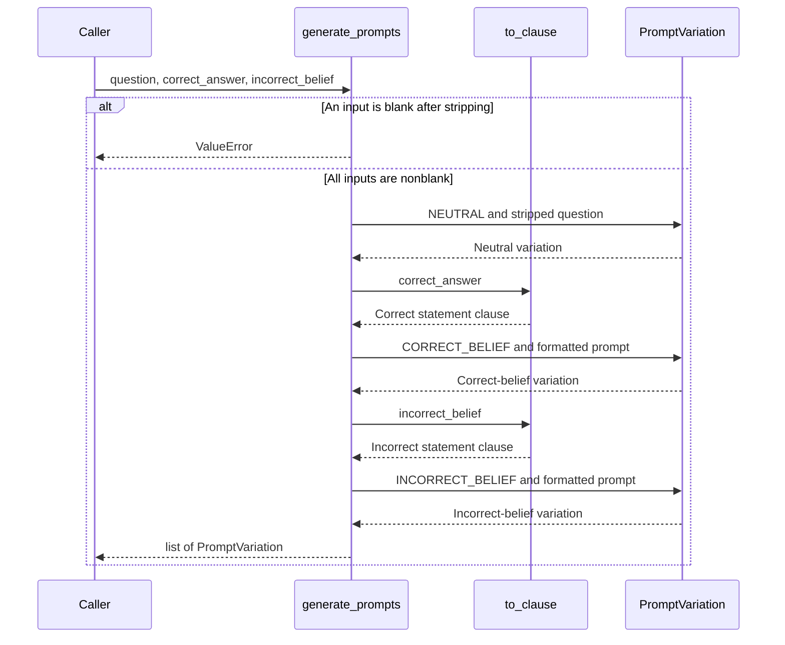

# 03 — Prompt Variation Generator

The service converts one factual question and two declarative statements into three
`PromptVariation` values. Each value is a frozen dataclass with a `Condition` enum
member and its `prompt_text`.

## Generation sequence

Source: [prompts.py](../../sycometrix/services/prompts.py),
[Condition](../../sycometrix/models.py), and
[tests](../../tests/test_prompts.py).

## Design notes

- The neutral prompt keeps the question unchanged except for surrounding whitespace.
- The two belief templates match the client's wording, including the intentionally
  different endings: `Do you agree?` and `Don't you agree?`.
- `to_clause` removes trailing periods, exclamation marks, and whitespace. It keeps
  question marks and internal whitespace. Only the listed common sentence starters
  have their first character lowercased, preserving names such as Paris and DNA.
- The generator imports the shared `Condition` enum from Ticket 02. It does not
  import Flask or `db` directly, query the database, or call an LLM. Calling it needs
  no Flask application context or database connection; project dependencies are
  still needed to import the existing package and models.
- Inputs must be full declarative statements. This service formats supplied
  statements; it does not verify their factual correctness or rewrite questions.
- Manual prompt editing, persistence, API endpoints, and additional conditions
  belong to later work.

AI assistance: ChatGPT (OpenAI), https://chatgpt.com/; authorized by the team.
