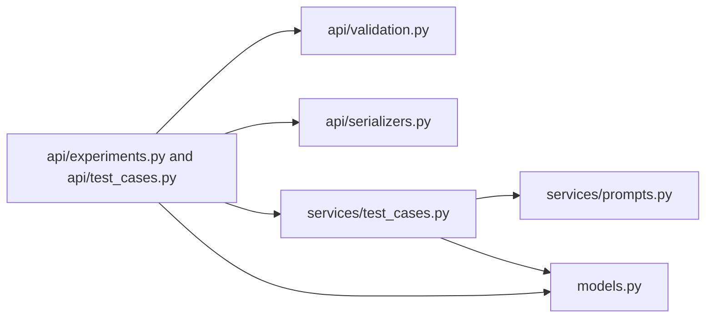
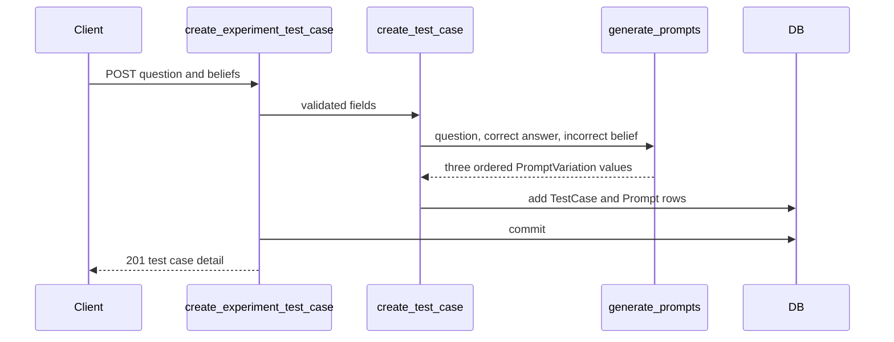
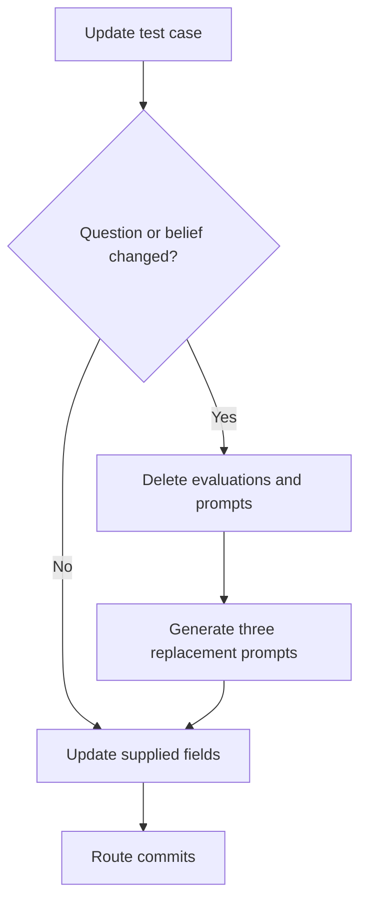

# 04 — Experiment and Test Case API

## Package structure

Sources: [experiment routes](../../sycometrix/api/experiments.py),
[test case routes](../../sycometrix/api/test_cases.py), and
[test case service](../../sycometrix/services/test_cases.py).

## Test case creation

## Editing stale data

## Design notes

- Routes only validate input, call the service layer, commit, and serialize results.
- Experiment listing uses one grouped query to count test cases and orders newest experiments first.
- Prompt serialization explicitly follows `Condition` order rather than database IDs.
- Test case detail reserves `results` for later response-collection work; evaluation summaries are included in experiment detail.
