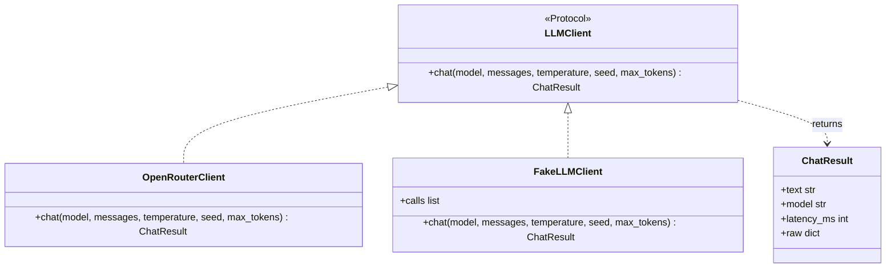
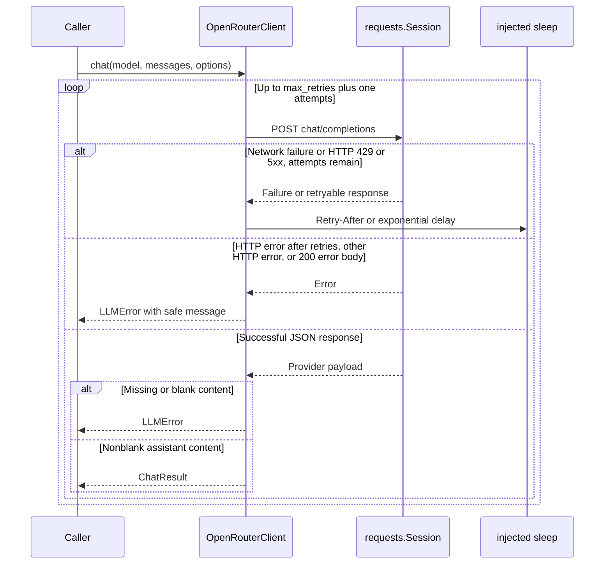
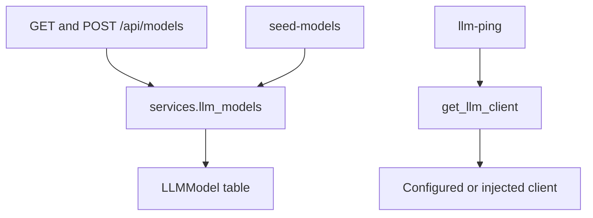

# 05 — LLM Client and Model Registry

Ticket: [05 — LLM Client](../implementation_plan/05-llm-client.md)

The client interface returns a `ChatResult` for one chat request. The real client
handles HTTP and retries; the fake supports development and tests. Model registry
routes and CLI commands manage the existing `LLMModel` table without changing its
schema. Sending and saving a test case's three responses belongs to Ticket 06.

## Client classes

Both implementations satisfy the protocol by providing `chat`; they do not need
to inherit from it. `get_llm_client()` first returns an injected client from
`current_app.extensions`, then selects a new fake or OpenRouter client using the
app configuration. A missing OpenRouter key or unknown provider raises `LLMError`.

Source: [llm_client.py](../../sycometrix/services/llm_client.py)

## Real request and retry sequence

The loop ends immediately on a return or raised exception. Network failures after
the final attempt also raise `LLMError`. Malformed JSON and unexpected response
shapes are rejected. HTTP `200` error objects are reported immediately rather
than being mistaken for answers.

`Retry-After` supports seconds and HTTP dates. Invalid headers fall back to
exponential backoff; no sleep happens after the final attempt. Latency measures
the whole call, including retries and their waits. Optional arguments are sent
only when not `None`, so numeric zero is preserved. Reasoning is not enabled.
Redirects are not followed automatically. The client preserves the returned
answer text and uses the response's model ID, falling back to the requested ID.

Provider error messages have the configured API key replaced with `[redacted]`.
Network exceptions are replaced with a generic error without displaying their
original traceback. Request headers and raw payloads are not logged. `raw` holds
the provider JSON for callers; model registry API responses do not expose it.

Source: [llm_client.py](../../sycometrix/services/llm_client.py),
[client tests](../../tests/test_llm_client.py)

## Model registry and commands

- Routes parse and validate input, call the registry service, commit successful
  writes, and use `serialize_llm_model`. The service uses SQLAlchemy 2.0 queries.
- A provider/model pair is unique. The service checks for an existing row and
  handles a uniqueness failure caused by concurrent insertion; it rolls back a
  failed insert before returning a duplicate error.
- `display_name` defaults to `model_name` when omitted or null. Explicit blank
  names are invalid. Length limits match the existing database columns.
- `seed-models` adds the configured default as an OpenRouter model only if it is
  missing, preserving an existing display name. The caller commits. Repeating
  the command is safe.
- `llm-ping` sends one prompt through the selected client, prints the reply and
  latency, and needs no registry row. A fake reply is not real-API verification.
- `FakeLLMClient` records a copy of the messages and all sampling arguments. Its
  default echoes at most 80 characters of the last user message with a fake
  prefix. A responder can supply scripted output. Judge JSON support remains
  explicitly reserved for Ticket 07.

Sources: [routes](../../sycometrix/api/llm_models.py),
[registry service](../../sycometrix/services/llm_models.py),
[serializer](../../sycometrix/api/serializers.py),
[CLI](../../sycometrix/cli.py),
[API and CLI tests](../../tests/test_api_llm_models.py)

## Integration with parallel work

Ticket 05 can run on Ticket 02 without Ticket 03 or 04. `serializers.py` contains
only `serialize_llm_model` in this version; retain it alongside Ticket 04's
serializers when merging. Preserve all route imports, CLI registrations, pytest
fixtures, and UML index rows added by other tickets. The extra registry service
keeps database logic out of routes and is shared by the API and seed command.

## References

- [OpenRouter chat endpoint](https://openrouter.ai/docs/api/api-reference/chat/create-a-chat-completion)
- [OpenRouter errors](https://openrouter.ai/docs/api_reference/errors-and-debugging)
- [OpenRouter limits](https://openrouter.ai/docs/api_reference/limits)
- [Flask CLI](https://flask.palletsprojects.com/en/stable/cli/)
