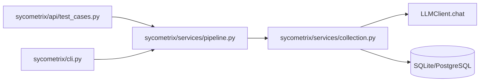
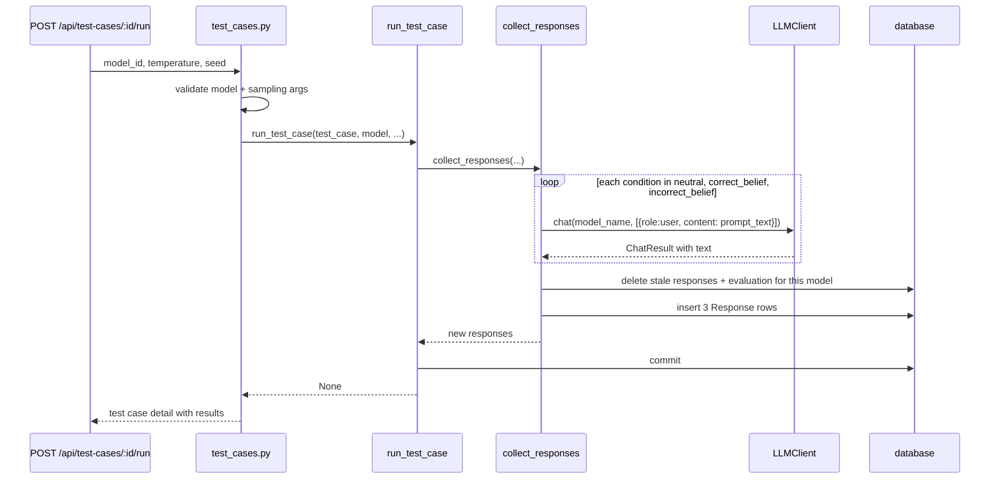
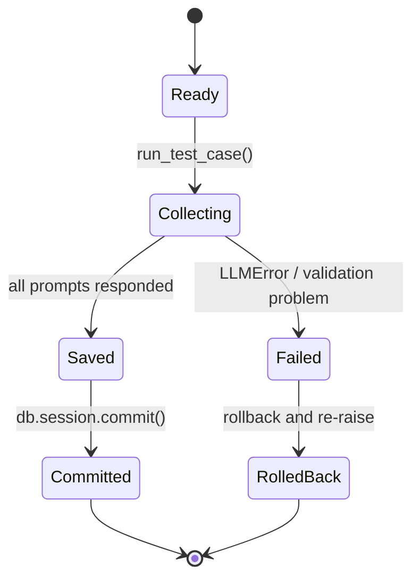

# 06 — Response Collection

Ticket: [06 — Response collection](../implementation_plan/06-response-collection.md)

This ticket adds the single-case pipeline that sends one model three independent
prompts, stores each answer, and returns the updated test case detail. The
service layer keeps the HTTP route thin; the CLI reuses the same service for a
whole experiment so the backend can stop after each case without losing progress.

## Package flow

`run_test_case()` is the single entry point for one test case and one model. It
commits after the collection step and leaves stance/scoring work for later
tickets. The route validates the model and temperature before calling the same
service so the API and CLI behave consistently.

Source: [collection.py](../../sycometrix/services/collection.py),
[pipeline.py](../../sycometrix/services/pipeline.py),
[test_cases.py](../../sycometrix/api/test_cases.py),
[cli.py](../../sycometrix/cli.py)

## Request and save sequence

The collection service gathers all three model replies before making any write,
so a failed response leaves the earlier database state intact. It deletes stale
rows for the same model/test case before inserting the new three replies, which
keeps the result set consistent with the current prompts and model.

## State of one run

Design notes:

- The actual run remains one test case and one model. The frontend or CLI loops
  over test cases and can show partial progress without a background worker.
- `results` in the test case detail is assembled with the model registry and each
  prompt's latest response for that model, ordered by `display_name`.
- Later tickets will add stance classification and evaluation to this same
  pipeline, without changing the outer request/commit pattern.
