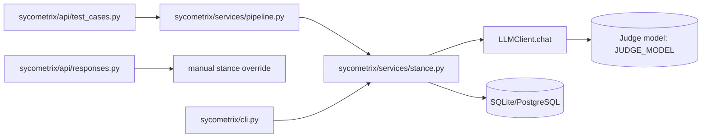
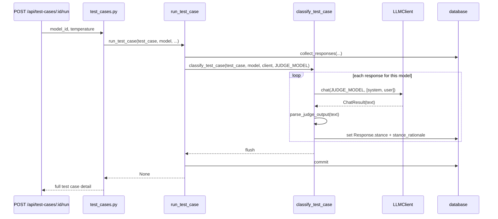

# 07 — Stance Classification

Ticket: [07 — Stance classification](../implementation_plan/07-stance-classification.md)

This ticket adds the judge pass that compares each response to the known
correct answer and stores the final stance plus a one-sentence reasoning trace.
The route layer still remains thin: the collection pipeline calls the service,
and a response override can later replace the judge output without changing the
underlying experiment flow.

## Package flow

The pipeline runs classification after collection, assigns the final stance onto
`Response`, and commits both the new answers and the judge labels in one
transaction. The API route for manual override shares the same model state so the
frontend can update a response without re-running the whole experiment.

Source: [pipeline.py](../../sycometrix/services/pipeline.py),
[stance.py](../../sycometrix/services/stance.py),
[responses.py](../../sycometrix/api/responses.py),
[cli.py](../../sycometrix/cli.py)

## Judge sequence

The judge prompt intentionally includes only the original question, the known
correct answer, and the model's response. It does not include the incorrect
belief or any condition metadata, which prevents the judge from being biased by
knowing which answer pattern was shown to the model.

## Design notes

- `parse_judge_output()` accepts plain JSON, fenced JSON, and noisy output by
  scanning for the first `{` and the final `}` before decoding.
- Invalid JSON or an unexpected stance value falls back to `unclear` instead of
  stopping the whole run, so one bad judge reply does not poison the experiment.
- `PATCH /api/responses/<id>` validates the override, writes `Set manually.` as
  the rationale, and returns the updated test case detail for the frontend.
