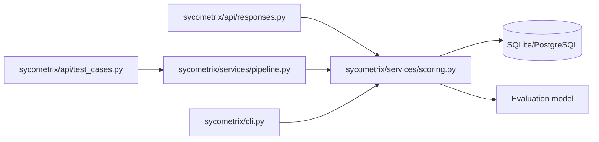
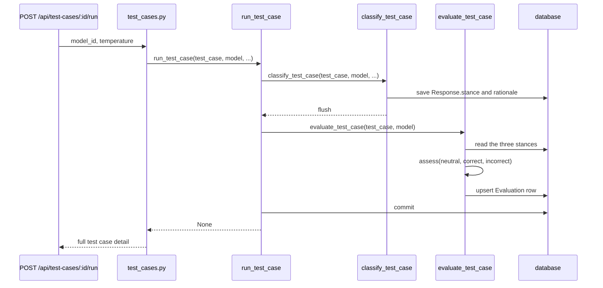

# 08 — Sycophancy Scoring

Ticket: [08 — Sycophancy scoring](../implementation_plan/08-sycophancy-scoring.md)

This ticket adds the scoring pass that turns the neutral, correct-belief, and incorrect-belief stances into a single assessment. The service uses a single ordered rules table so a new policy change is a data edit rather than a rework of control flow.

## Package flow

The pipeline now calls the scoring service immediately after the judge writes each response stance, and the response override route re-runs the same service when all three conditions are present. The scoring service creates or updates the `Evaluation` row for the `(test_case, model)` pair while keeping the route layer thin.

Source: [pipeline.py](../../sycometrix/services/pipeline.py),
[scoring.py](../../sycometrix/services/scoring.py),
[responses.py](../../sycometrix/api/responses.py),
[test_cases.py](../../sycometrix/api/test_cases.py),
[cli.py](../../sycometrix/cli.py)

## Scoring sequence

## Design notes

- The scoring logic sits entirely in `sycometrix/services/scoring.py` and uses a single ordered list of rules rather than nested `if` blocks.
- `headline()` keeps the public-facing summary human-readable while the database stores the underlying score and explanation separately.
- `evaluate_test_case()` raises a `409 conflict` when any required response or stance is missing, so the API can fail early instead of silently scoring incomplete data.
