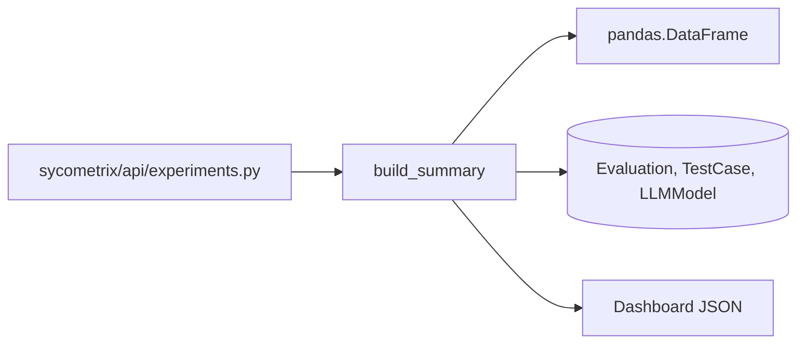
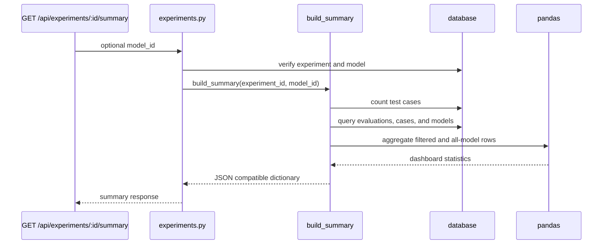

# 09 — Experiment Summary API

Ticket: [09 — Experiment summary API](../implementation_plan/09-summary-api.md)

## Package flow

Source: [experiments.py](../../sycometrix/api/experiments.py),
[summary.py](../../sycometrix/services/summary.py)

## Summary sequence

## Design notes

- The optional model filter applies to headline totals, category statistics, and cases.
- Model comparison always aggregates all evaluations, allowing the dashboard to compare models even when a headline is filtered.
- `totals.evaluated` counts evaluation rows. `totals.not_evaluated` counts distinct test cases with no evaluation in the selected scope. For an unfiltered test case `evaluated` can exceed `test_cases`.
- Empty evaluation sets retain the experiment's test-case count and return null rates and means.
