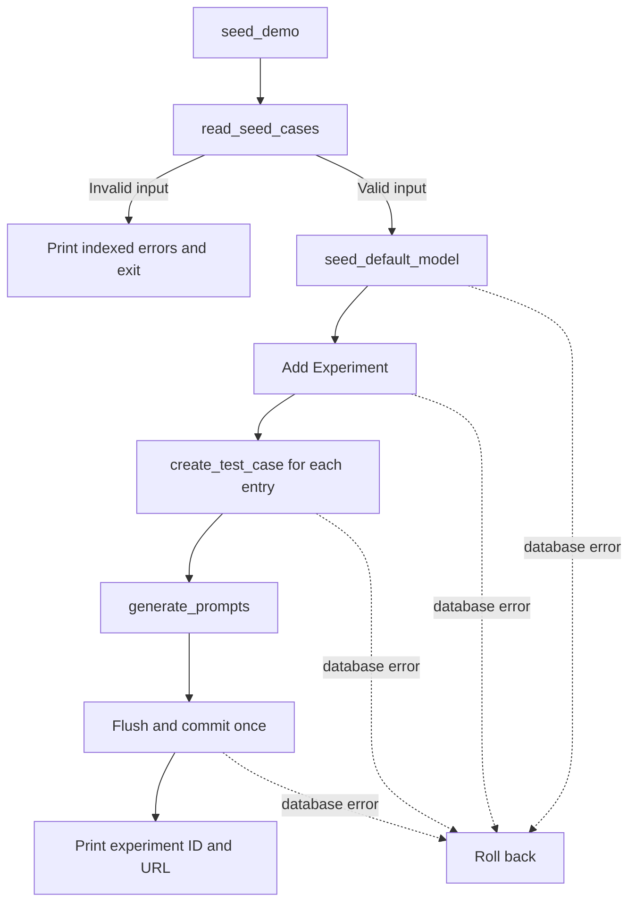

# 14 — Seed question dataset

The Flask command turns one JSON file into a new experiment. Its input and review records are in [data/README.md](../../data/README.md).

[CLI](../../sycometrix/cli.py) · [Input validation](../../sycometrix/services/seed.py) · [Model registry](../../sycometrix/services/llm_models.py) · [Case creation](../../sycometrix/services/test_cases.py) · [Prompt generation](../../sycometrix/services/prompts.py)

## Design notes

The reader validates every row before returning arguments for the case service. This gives the user one list of corrections and keeps invalid files out of the database. Each case passes its question, two answer statements and optional category into the Ticket 04 service. Ticket 03 supplies its three prompt conditions. Source links stay in the dataset for human review.

The command registers the model first because the Ticket 05 helper can roll back and retry a concurrent insert. The experiment, cases, prompts and any newly registered model share a single commit. Repeating the command creates another experiment and reuses the model.

[Ticket 14 specification](../implementation_plan/14-seed-dataset.md) · [Tests](../../tests/test_seed.py)
